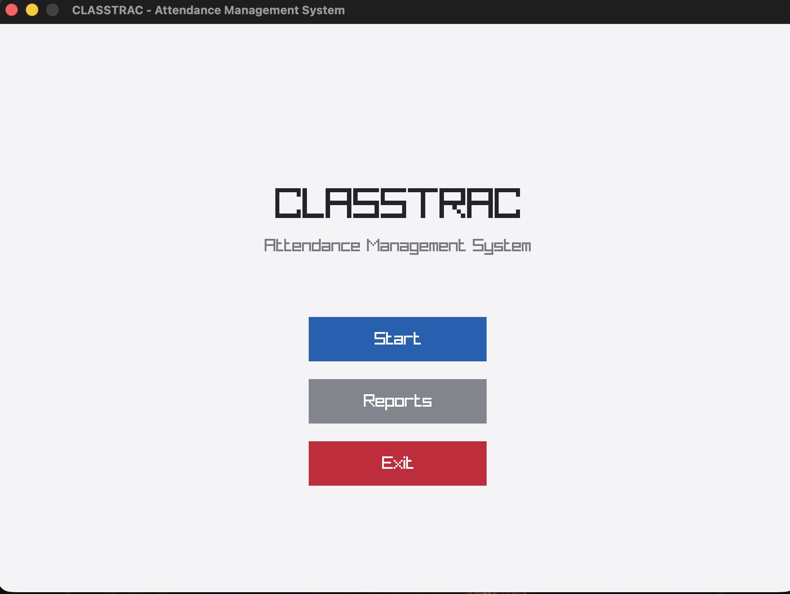
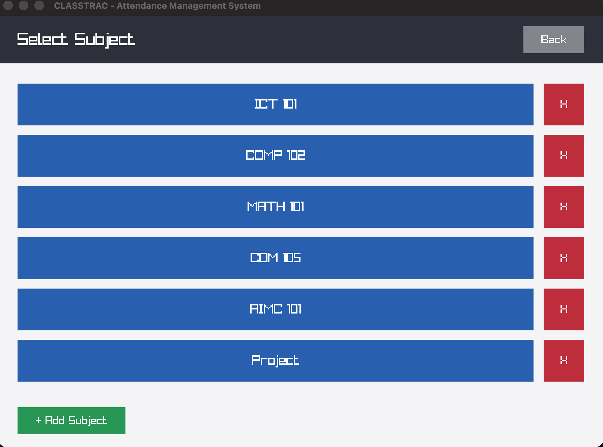
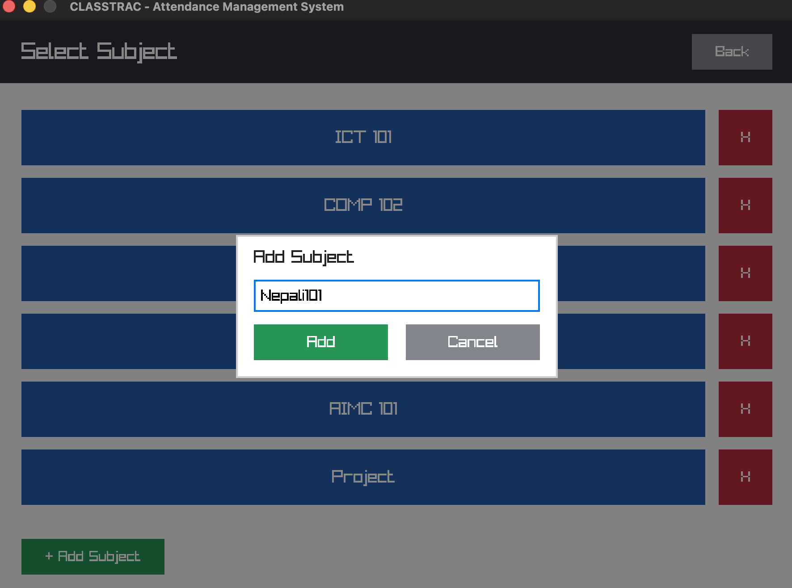
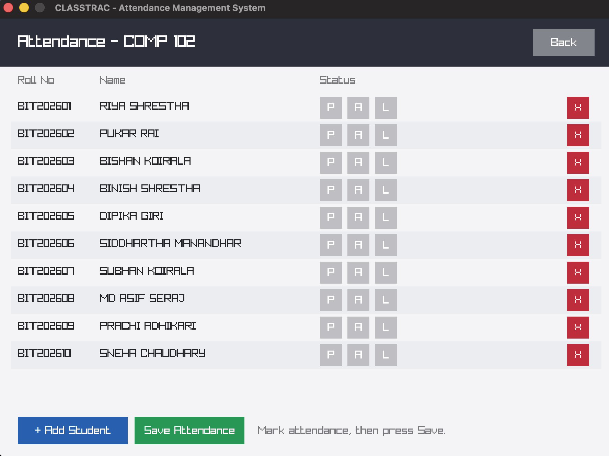
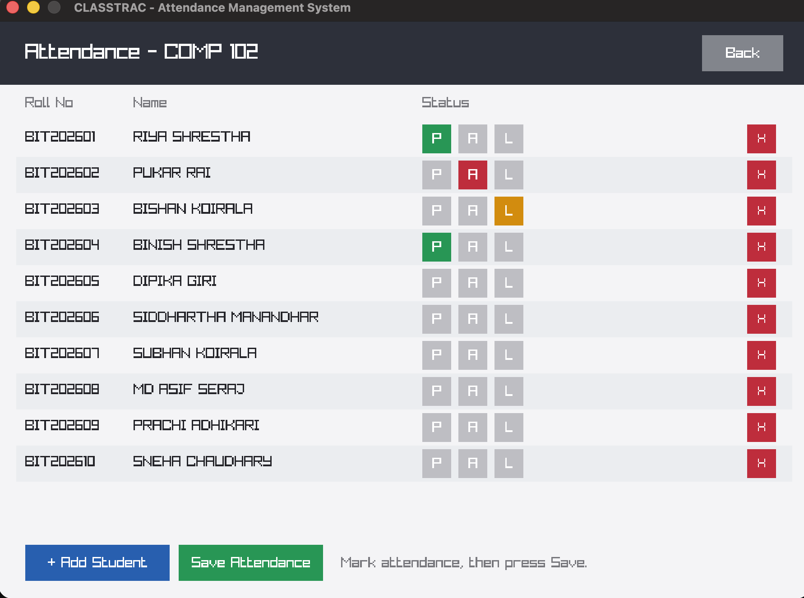
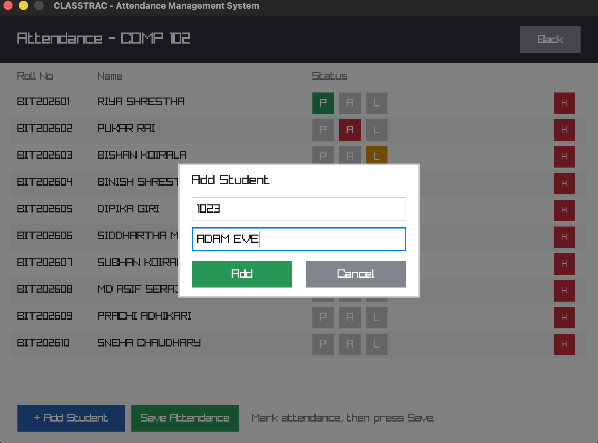
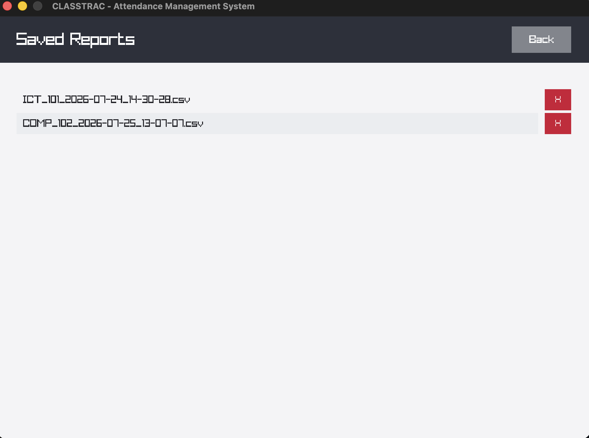
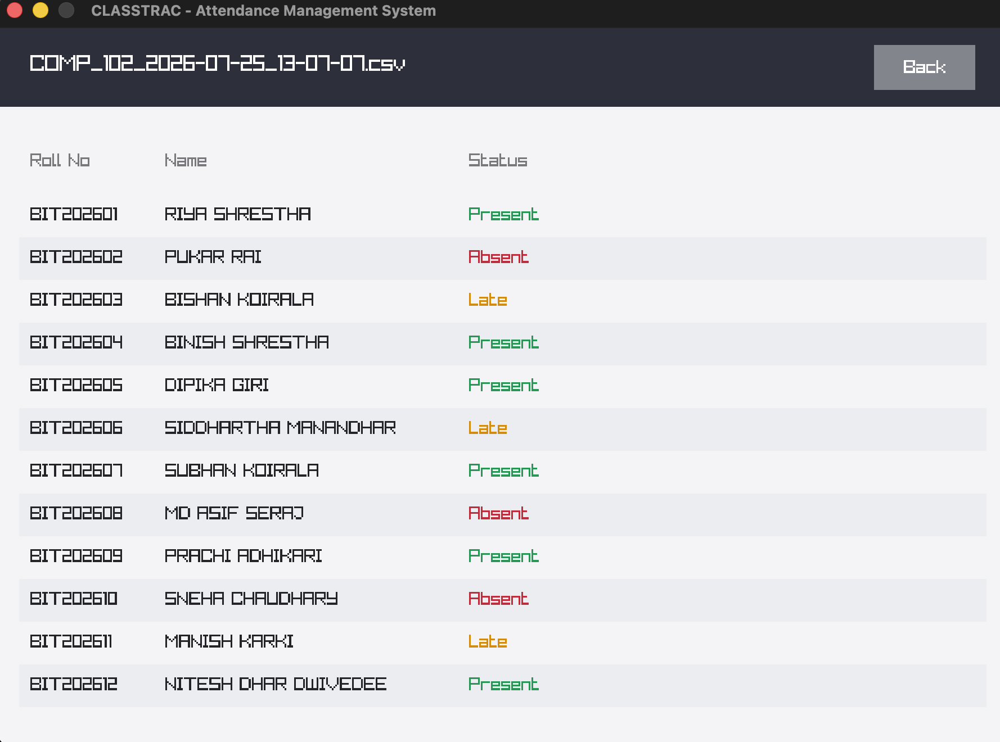
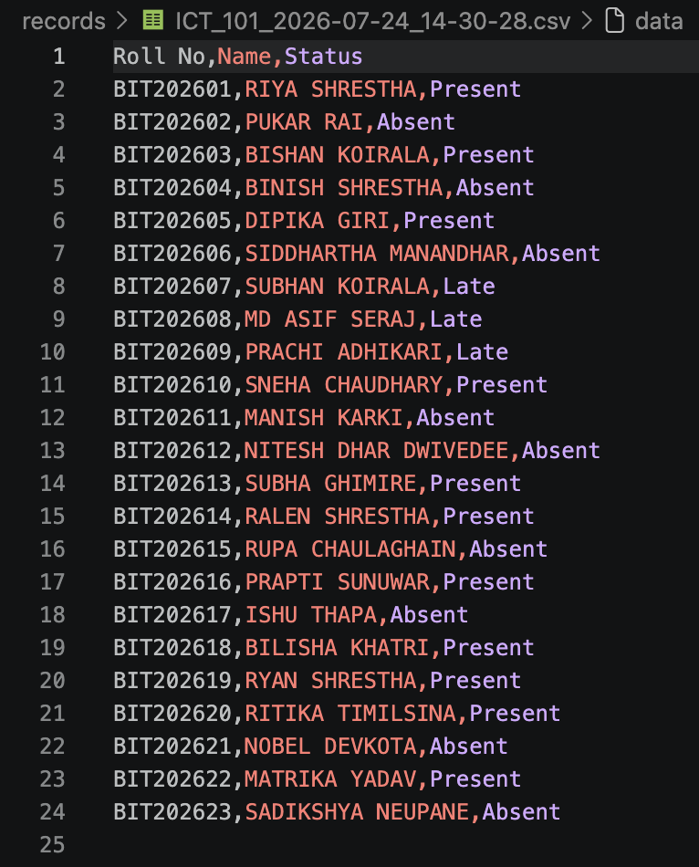
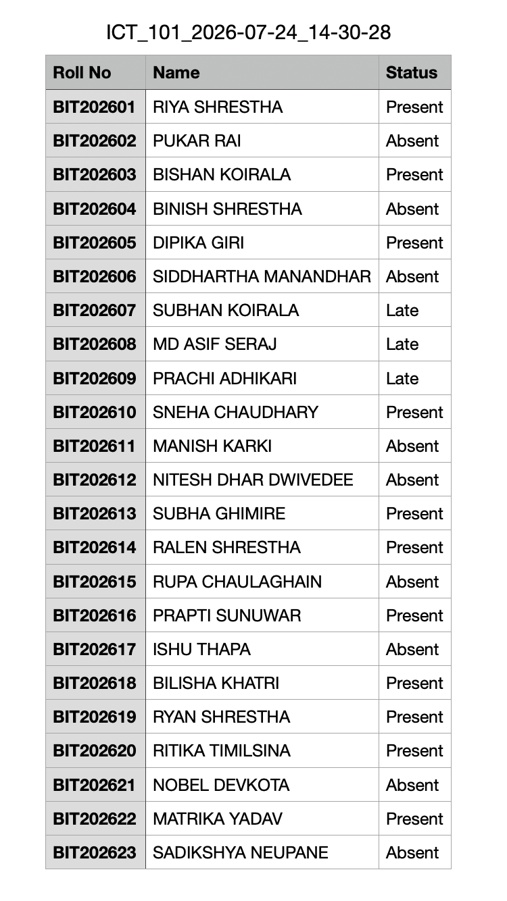

# ClassTrac

A desktop attendance tracker written in C with [raylib](https://www.raylib.com/). Pick a subject, mark each student Present, Absent or Late, and save the session as a dated CSV file. Saved sessions can be reopened or deleted from inside the app.

We built it to practise structs, enums, arrays, file handling and splitting a C program into modules.

## Screenshots

<table>
  <tr>
    <td align="center"><br><sub>Home</sub></td>
    <td align="center"><br><sub>Subject list</sub></td>
  </tr>
  <tr>
    <td align="center"><br><sub>Adding a subject</sub></td>
    <td align="center"><br><sub>Attendance screen</sub></td>
  </tr>
  <tr>
    <td align="center"><br><sub>Marking P / A / L</sub></td>
    <td align="center"><br><sub>Adding a student</sub></td>
  </tr>
  <tr>
    <td align="center"><br><sub>Saved reports</sub></td>
    <td align="center"><br><sub>Opening a report</sub></td>
  </tr>
</table>

The screenshots we took while testing (empty input, deleting, scrolling and so on) are in [`screenshots/extra`](screenshots/extra).

## What it does

- Add and delete subjects
- Add and remove students
- Mark each student Present, Absent or Late with one click
- Save the session as `<Subject>_<YYYY-MM-DD>_<HH-MM-SS>.csv` in the `records/` folder
- List saved reports newest first, open them in a colour-coded table, or delete them

## Saved reports

Each report is a plain CSV file, so it also opens in Excel or Google Sheets.

<table>
  <tr>
    <td></td>
    <td></td>
  </tr>
</table>

## Running it

You need `gcc`, `make` and raylib installed.

```
git clone https://github.com/nobeliumjuju/ClasstracF.git
cd ClasstracF
make run
```

The Makefile sets the linker flags for Windows (MinGW), macOS and Linux. Our screenshots were taken on macOS, which is the only setup we have actually run it on. `make clean` removes the build output.

## Project layout

| File | What it holds |
| --- | --- |
| `main.c` | Window setup, main loop, the subject and student lists in memory |
| `classtrac.h` | Shared enums, structs, constants and colours |
| `ui.c` | Button, text input box and keyboard input |
| `home_screen.c`, `subject_screen.c`, `attendance_screen.c`, `report_screen.c` | One file per screen |
| `storage.c` | Creating the records folder, saving, listing, reading and deleting CSV files |

A `currentScreen` variable decides which screen gets drawn each frame, and each screen redraws everything every frame (raylib's immediate-mode style).

## Limitations

- The starting subjects and the student roster are written directly in `main.c`. Changes made while the app is running are lost when it closes. Only saved attendance sessions persist.
- Deleted subjects, students and reports cannot be recovered.
- Single user, mouse only.
